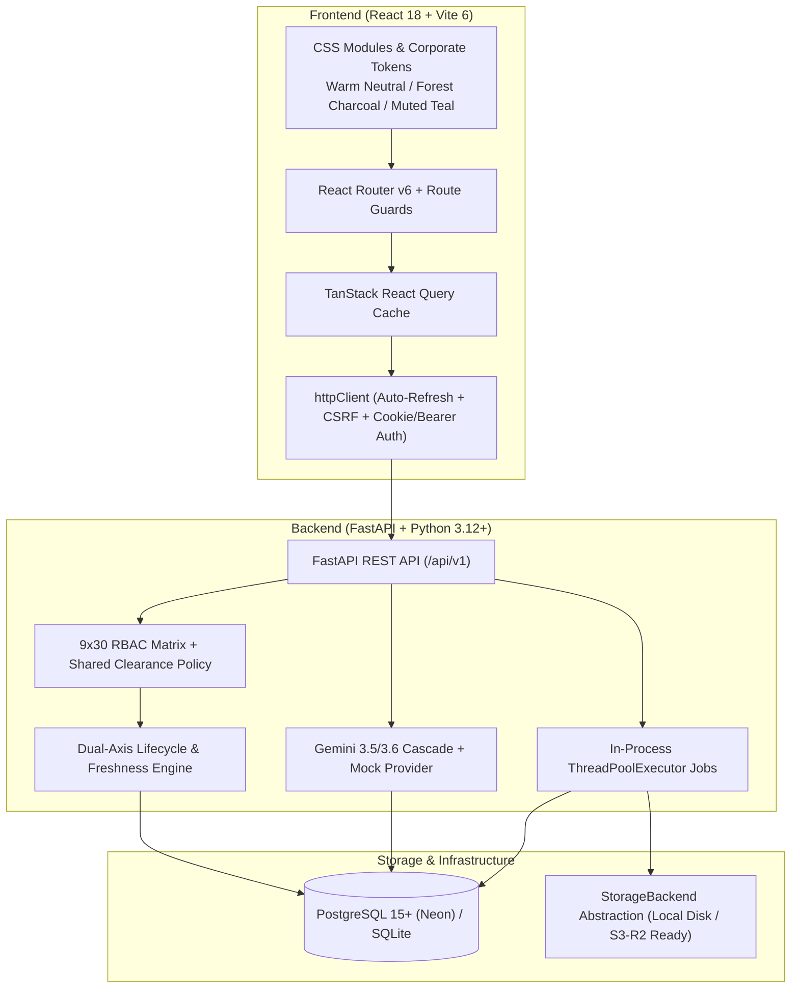

# HandoffScope

<p align="center">
  <strong>Evidence-led, permission-aware project handover platform for engineering teams.</strong>
</p>

<p align="center">
  
  
  
  
  
  
  
</p>

---

## 🎯 The Problem

Engineering knowledge transfers consistently fail because they rely on rushed 1-on-1 walkthroughs, stale wikis, and undocumented tribal knowledge:
1. **Unverifiable Claims:** Handover documents state *"Auth service is production-ready"* without linking to the PR review, deployment checklist, or architectural decision.
2. **Permission Leaks:** Successors or departing staff are either over-permissioned (seeing sensitive credentials or confidential HR notes) or under-permissioned.
3. **No Proof of Understanding:** A successor saying *"I read the document"* is not an acceptance of operational ownership.
4. **Stale Runbooks:** Repositories evolve while handovers remain frozen in time.
5. **LLM Hallucinations:** Generic AI summarizers invent architectural claims with fake references.

## 💡 The Solution: HandoffScope

HandoffScope treats engineering handovers as an **evidence-backed, permission-aware workflow**:
- **Automatic Ingestion:** Ingests issues, PRs, review discussions, commits, and uploaded technical documentation (`.pdf`, `.docx`, `.md`, `.txt`).
- **Ground-Truth Claims:** Every claim links directly to its source citations. Unknown is a valid output.
- **Conflict Visibility:** Architecture disagreements between engineers are explicitly highlighted as `CONFLICTING` claims instead of being silently averaged away.
- **Dual-Dimension State Machine:** Decouples handover lifecycle status (`DRAFT` → `RECONSTRUCTING` → `UNDER_REVIEW` → `APPROVED` → `SHARED` → `TRANSFERRED`) from data freshness (`CURRENT`, `POTENTIALLY_STALE`, `CHANGED_SINCE_APPROVAL`).
- **Strict 9×30 RBAC Matrix:** Enforces boundary checks so restricted evidence is automatically redacted from successor views.
- **Formal Responsibility Acceptance:** Successors individually accept or decline operational ownership per Transfer Pack with required justification.

---

## 🏛️ Architecture & Tech Stack



---

## 👥 Demo Personas (Pre-Seeded)

All accounts share the default demo password: **`handoffscope-dev-2026`**

| Persona | Email | Workspace Role | Project Role | Operational Role in Demo |
|---|---|---|---|---|
| **Maya Sharma** | `maya.sharma@example.test` | `OWNER` | `LEAD` | Project Lead & Handover Initiator. Manages case lifecycle and team access. |
| **Arjun Patel** | `arjun.patel@example.test` | `ADMIN` | `CONTRIBUTOR` | Departing Lead Developer. Primary author of auth, caching, and payment services. |
| **Kabir Singh** | `kabir.singh@example.test` | `MEMBER` | `REVIEWER` | Reviewer. Reviews claims, verifies evidence, approves immutable version snapshots. |
| **Aisha Khan** | `aisha.khan@example.test` | `MEMBER` | `REVIEWER` | Designated Successor. Continuation workspace, accepts/declines pack ownership. |
| **Neha Gupta** | `neha.gupta@example.test` | `MEMBER` | `CONTRIBUTOR` | Observability & Tracing Contributor. |
| **Dev Mehta** | `dev.mehta@example.test` | `MEMBER` | `CONTRIBUTOR` | DevOps & Database Migrations Contributor. |
| **Priya Nair** | `priya.nair@example.test` | `MEMBER` | `CONTRIBUTOR` | QA & Testing Specialist. |

---

## 🎬 7-Minute Judge Walkthrough Script

### Act 1 — The Project Lead Sets the Scope (1 min)
1. **Login as Maya Sharma** (`maya.sharma@example.test` / `handoffscope-dev-2026`).
2. Navigate to **Overview** (`/`) — observe the live dashboard metrics: 3 Projects, Active Cases, Connected Sources, and Pending Reviews.
3. Open **Projects** → select **Atlas Platform** (`/projects/:id`).
4. View **Sources** (`/sources`) — observe the synthetic history: **18 Issues, 10 PRs, 35 Commits, and 5 Technical Documents**.
5. Click **"Check Freshness"** to verify upstream staleness propagation.

### Act 2 — Knowledge Reconstruction & Evidence Inspection (1.5 min)
6. Open **Handover Cases** → select **"Arjun Patel - Atlas Platform Handover"** (`/cases/:id`).
7. Inspect the **4 Transfer Packs**:
   - **Authentication API & Multi-Tenancy** (5 claims)
   - **Payment Integration Service** (4 claims)
   - **Database Migrations & Schema v2** (3 claims)
   - **Deployment Operations & Staging** (3 claims)
8. Open **Authentication API & Multi-Tenancy**:
   - Point out the **`CONFLICTING`** architecture decision: Arjun's Issue #3 (microservices) vs. Kabir's Issue #13 (monolith). Both citations are visible side-by-side.
   - Point out the **`UNKNOWN`** knowledge gap: *"No evidence of production deployment testing or latency benchmarks found."*
   - Point out the source authority rule: PR #101 was merged, but Issue #12 remained open.

### Act 3 — The Targeted Question Loop (1 min)
9. Navigate to the **Questions Tab** on the case (or `/questions`).
10. Notice the question: *"What is the current deployment process for the auth service?"*
11. View Arjun's answer explaining the manual staging script and credentials procedure.
12. Review the accepted answer signed off by the Lead.

### Act 4 — Review & Immutable Version Approval (1 min)
13. Switch login to **Kabir Singh** (`kabir.singh@example.test` / `handoffscope-dev-2026`).
14. Open the **Review Queue** (`/review`).
15. Inspect claims filtered by review state (`PENDING_REVIEW`, `ACCEPTED`, `NEEDS_CLARIFICATION`).
16. Show that Kabir approved **Version Snapshot v1**:
    - An immutable JSON snapshot is frozen in the database.
    - Future repository edits do not tamper with this historical record.

### Act 5 — Successor Continuation & Permission Redaction (1.5 min)
17. Switch login to **Aisha Khan** (`aisha.khan@example.test` / `handoffscope-dev-2026`).
18. Navigate to **Successor View** (`/successor`).
19. Highlight the **Access Blockers & Redaction Guarantee**:
    - The restricted document (*"Production Vault Access & Cloud Credentials Runbook"*) is **NOT accessible** to Aisha.
    - Instead, an explicit blocker notice is displayed: *"Restricted Evidence Withheld — Evidence source requires elevated clearance."*
20. Show the 4 actionable continuation pillars:
    - *What am I taking over?* (Transfer packs and claims)
    - *What are my next actions?* (Operational checklist)
    - *What's unfinished?* (Gaps and open items)
    - *What do I not have access to?* (Blocked credentials/documents)

### Act 6 — Responsibility Transfer Sign-Off (1 min)
21. Aisha formally acknowledges case receipt.
22. Aisha **Accepts** the *Authentication API & Multi-Tenancy* transfer pack.
23. Aisha **Declines** the *Payment Integration Service* transfer pack with required reason: *"Need additional training on the payment gateway SDK before taking sole ownership."*
24. Return to the case summary: the case honestly reflects **`PARTIALLY_ACKNOWLEDGED`** rather than fabricating a "100% complete" transfer.
25. Open **Audit Log** (`/audit`) — every creation, review, approval, share, acknowledgement, and decline is permanently recorded.

---

## 🚀 Quickstart & Setup

### Option A: Local Development (Fastest — Pure Python & Node)

```bash
# 1. Seed demo data (idempotent, pre-seeds users, sources, packs, version v1)
cd backend
python -m app.seed.demo_seed

# 2. Run Backend (FastAPI on http://localhost:8000)
python -m uvicorn app.main:app --reload --port 8000

# 3. Run Frontend (React + Vite on http://localhost:5173)
cd ../frontend
npm install
npm run dev
```

### Option B: Docker Compose (PostgreSQL + Backend + Frontend)

```bash
# Spin up PostgreSQL, FastAPI Backend (in-process ThreadPoolExecutor), and Frontend
docker compose -f docker-compose.prod.yml up -d --build
```

---

## 🧪 Automated Test Suite (61 Tests Passing)

The test suite covers unit and API integration tests:
```bash
cd backend
python -m pytest tests/
```

| Test File | Focus Area |
|---|---|
| `test_health_api.py` | Health endpoints, readiness probes |
| `test_identity_and_timeline_api.py` | Identity mapping & unified timeline |
| `test_pack_restructuring_api.py` | Transfer pack split/merge & claim movements |
| `test_questions_api.py` | Targeted question lifecycle & respondent answers |
| `test_recipient_and_responsibility_api.py` | Share grants, acknowledgement & acceptance |
| `test_reconstruction_and_evidence_api.py` | AI pipeline grounding & evidence state engine |
| `test_reviews_api.py` | Sequential versioning & immutable JSON snapshots |
| `test_judge_e2e_flow.py` | **19-step end-to-end judge walkthrough verification** |
| `test_security.py` | Password hashing, JWT cookie security, CSRF protection |
| `test_state_machine.py` | 16-transition lifecycle state machine & invariant checks |
| `test_parsers.py` | Document ingestion (`.pdf`, `.docx`, `.md`) |
| `test_r3_0_foundations.py` | Clearance policy, GitHub URL auto-linking & member RBAC hardening |
| `test_r3_1_compliance_exports.py` | Signed compliance ZIP/PDF exports, Ed25519 verification & clearance filtering |
| `test_r3_2_conversational_rag.py` | Snapshot-pinned conversational RAG assistant & restricted withholding |
| `test_r3_3_connectors_and_tree.py` | GitLab, Jira, Linear connectors, tree indexing & suggested identity hints |
| `test_r3_4_hardening.py` | SigV4 R2/S3 storage ACLs, GitHub/SSE security, redactor & claim delegation |

---

## 🌐 Cloud Deployment Topology

- **Frontend:** Hosted on **Vercel** (`dist/` static SPA build with React Router rewrite rule).
- **Backend:** Hosted on **Render** (FastAPI Web Service via Docker or native Python).
- **Database:** Hosted on **Neon.tech** or **Render Managed PostgreSQL** (`DATABASE_URL=postgresql+psycopg2://...`).
- **AI Models:** Deterministic offline **Mock Provider** or Google Gemini REST cascade (`gemini-3.5-flash` → `gemini-3.6-flash` → `gemini-3.5-flash-lite` → `MockLLMProvider`).

---

## 📜 License

MIT License. Built for the Hackathon Engineering Transition Platform Challenge.
