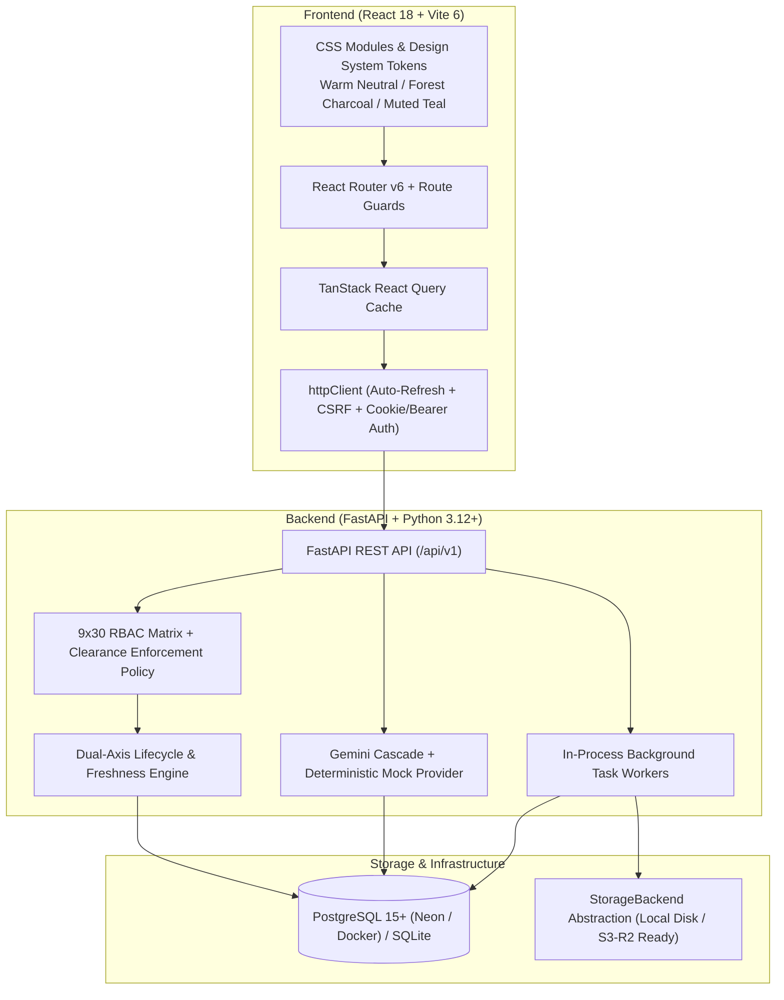

# HandoffScope

<p align="center">
  <strong>Evidence-led, permission-aware project handover platform for engineering teams.</strong>
</p>

<p align="center">
  
  
  
  
  
  
  
  
</p>

---

## 🎯 The Problem

Engineering knowledge transfers consistently fail because traditional handovers rely on rushed 1-on-1 meetings, stale wikis, and undocumented tribal knowledge:

1. **Unverifiable Claims:** Handover documents declare *"Auth service is ready for production"* without linking to the pull request, architectural decision record (ADR), or deployment runbook.
2. **Permission Leaks & Exposure:** Successors or departing engineers are either over-permissioned (accidentally exposing production secrets or confidential HR notes) or under-permissioned (blocked from critical runbooks).
3. **No Proof of Understanding:** A successor acknowledging *"I read the document"* is not an acceptance of operational ownership.
4. **Stale Runbooks:** Repositories and architectures evolve continuously while handover documents remain frozen snapshots.
5. **LLM Hallucinations:** Generic AI summarizers invent architectural claims with phantom references.

---

## 💡 The Solution: HandoffScope

HandoffScope transforms engineering handovers into an **evidence-backed, permission-aware, verifiable workflow**:

- **Multi-Source Ingestion:** Ingests issues, pull requests, commit histories, review discussions, and uploaded technical documentation (`.pdf`, `.docx`, `.md`, `.txt`) across GitHub, GitLab, Jira, and Linear.
- **Ground-Truth Claims:** Every claim links directly to its source citations. Unknown is a first-class valid output.
- **Architectural Decision Regeneration:** Re-synthesizes architectural decisions across the entire case or for individual claims from ingested project sources, runbooks, and git commits with real-time freshness updates.
- **Interactive Project Git History:** GitHub-style interactive commit timeline right inside the project view, featuring search by message/SHA, author filters, and date-grouped views.
- **Inline Document Preview & New-Tab Access:** Native browser-tab viewing for technical documentation and source evidence via `/api/v1/documents/{id}/view` (`Content-Disposition: inline`).
- **Question Response Resource Attachments:** When answering or amending targeted questions, engineers can attach local files or link existing repository commits, pull requests, and issues.
- **Dual-Dimension State Machine:** Decouples handover lifecycle status (`DRAFT` → `RECONSTRUCTING` → `UNDER_REVIEW` → `APPROVED` → `SHARED` → `PARTIALLY_ACKNOWLEDGED` → `ACKNOWLEDGED` → `TRANSFERRED`) from data freshness (`CURRENT`, `POTENTIALLY_STALE`, `CHANGED_SINCE_APPROVAL`).
- **Strict 9×30 RBAC Matrix & Clearance Redaction:** Enforces boundary checks so restricted evidence is automatically redacted from successor views with explicit withholding notices.
- **Formal Responsibility Acceptance:** Successors individually accept or decline operational ownership per Transfer Pack with required justification.
- **Enterprise Compliance Exports:** Generates cryptographically signed, offline-verifiable ZIP and PDF handover packages with Ed25519 digital signatures and audit verification.
- **Snapshot-Pinned Conversational RAG:** Context-grounded chat assistant pinned to immutable case snapshot versions.

---

## 🏛️ Architecture & Tech Stack



### Technology Breakdown
- **Backend:** FastAPI, Python 3.12+, SQLAlchemy 2.0 (async & sync engines), Pydantic v2, Alembic, Argon2 password hashing, python-jose (JWT), PyMuPDF, python-docx, ReportLab.
- **Frontend:** React 18, Vite 6, TanStack React Query v5, React Router v6, Lucide React icons, CSS Modules with strict design tokens.
- **Database:** PostgreSQL 15+ (Neon.tech or Docker Compose) / SQLite for instant local zero-dependency development.
- **AI Integration:** Google Gemini REST cascade (`gemini-3.5-flash` → `gemini-3.6-flash` → `gemini-3.5-flash-lite` → `MockLLMProvider`) ensuring offline and local execution works deterministically without API keys.

---

## 👥 Pre-Seeded Demo Personas

All seeded accounts share the default development password: **`handoffscope-dev-2026`**

| Persona | Email | Workspace Role | Project Role | Operational Role in Demo |
|---|---|---|---|---|
| **Maya Sharma** | `maya.sharma@example.test` | `OWNER` | `LEAD` | Project Lead & Handover Initiator. Manages case lifecycle and team access. |
| **Arjun Patel** | `arjun.patel@example.test` | `ADMIN` | `CONTRIBUTOR` | Departing Lead Developer. Primary author of auth, caching, and payment services. |
| **Kabir Singh** | `kabir.singh@example.test` | `MEMBER` | `REVIEWER` | Reviewer. Reviews claims, verifies evidence, approves immutable version snapshots. |
| **Aisha Khan** | `aisha.khan@example.test` | `MEMBER` | `REVIEWER` | Designated Successor. Continuation workspace, accepts/declines pack ownership. |
| **Neha Gupta** | `neha.gupta@example.test` | `MEMBER` | `CONTRIBUTOR` | Observability & Tracing Contributor. |
| **Dev Mehta** | `dev.mehta@example.test` | `MEMBER` | `CONTRIBUTOR` | DevOps & Database Migrations Contributor. |
| **Priya Nair** | `priya.nair@example.test` | `MEMBER` | `CONTRIBUTOR` | QA & Testing Specialist. |

---

## 🚀 Getting Started & Setup Guide

### 1. Clone the Repository

```bash
git clone https://github.com/EhsaasBhalla/HandoffScope.git
cd HandoffScope
```

---

### Option A: Local Development (Without Docker — Recommended for Fast Iteration)

#### Step 1: Backend Setup (FastAPI + Python 3.12+)

1. Navigate to the backend directory:
   ```bash
   cd backend
   ```

2. Create and activate a Python virtual environment:
   - **Linux / macOS:**
     ```bash
     python3 -m venv venv
     source venv/bin/activate
     ```
   - **Windows (PowerShell):**
     ```powershell
     python -m venv venv
     .\venv\Scripts\Activate.ps1
     ```

3. Install dependencies using `requirements.txt`:
   ```bash
   pip install --upgrade pip
   pip install -r requirements-dev.txt
   ```
   *(Alternatively: `pip install -r requirements.txt` or `pip install -e ".[dev]"`)`*

4. Configure environment variables (optional for local SQLite execution):
   ```bash
   cp ../.env.example .env
   ```
   *Note: By default, the application runs with hermetic SQLite (`handoffscope.db`) and offline deterministic Mock LLM provider if no external credentials are provided.*

5. Seed demo data (idempotent; creates users, workspace, projects, transfer packs, and demo history):
   ```bash
   python -m app.seed.demo_seed
   ```

6. Start the FastAPI server:
   ```bash
   python -m uvicorn app.main:app --reload --port 8000
   ```

- **Backend Health Check:** [http://localhost:8000/health](http://localhost:8000/health)
- **Interactive OpenAPI Documentation:** [http://localhost:8000/api/v1/docs](http://localhost:8000/api/v1/docs)

---

#### Step 2: Frontend Setup (React 18 + Vite 6)

1. Open a new terminal and navigate to the frontend directory:
   ```bash
   cd frontend
   ```

2. Install Node dependencies:
   ```bash
   npm install
   ```

3. Start the Vite development server:
   ```bash
   npm run dev
   ```

4. Open your browser and navigate to:
   - **Web Application:** [http://localhost:5173](http://localhost:5173)

---

### Option B: Running with Docker & Docker Compose

Docker Compose builds and starts the PostgreSQL database, the FastAPI backend, and the Vite frontend in containerized environments.

#### Development Mode (with hot-reload and volume mounts):
```bash
# From the repository root:
docker compose up --build
```

#### Production-Grade Stack:
```bash
# Runs PostgreSQL, production-configured FastAPI, and compiled SPA build:
docker compose -f docker-compose.prod.yml up -d --build
```

- **Frontend:** [http://localhost:5173](http://localhost:5173)
- **Backend API:** [http://localhost:8000](http://localhost:8000)
- **PostgreSQL:** `localhost:5432` (database: `handoffscope`, user: `handoffscope`)

To stop the containers:
```bash
docker compose down
```

---

## 🧪 Automated Test Suite (69 Tests Passing)

The test suite covers unit models, parsers, security, RBAC matrices, and full end-to-end integration workflows.

To run the full test suite:
```bash
cd backend
python -m pytest tests/ -v
```

### Test Coverage Summary:
| Test File | Focus Area |
|---|---|
| `test_pipeline_e2e_git_decisions_resources.py` | **Full end-to-end pipeline test** (project creation, git history query, inline document view, case reconstruction, decision regeneration, and question response attachments) |
| `test_judge_e2e_flow.py` | **19-step end-to-end walkthrough verification** across all user personas |
| `test_health_api.py` | Health endpoints, readiness probes, and database ping |
| `test_identity_and_timeline_api.py` | Identity mapping & unified activity timeline |
| `test_pack_restructuring_api.py` | Transfer pack split/merge & claim movements |
| `test_questions_api.py` | Targeted question lifecycle, responses, and reviews |
| `test_recipient_and_responsibility_api.py` | Share grants, formal acknowledgement & acceptance/decline |
| `test_reconstruction_and_evidence_api.py` | AI pipeline grounding, citations & evidence state engine |
| `test_reviews_api.py` | Sequential versioning & immutable JSON snapshots |
| `test_security.py` | Password hashing (Argon2), JWT cookie security, CSRF protection |
| `test_state_machine.py` | 16-transition lifecycle state machine & invariant checks |
| `test_parsers.py` | Multi-format document ingestion (`.pdf`, `.docx`, `.md`, `.txt`) |
| `test_core_pipeline_regressions.py` | Ingestion deduplication, job dispatching, and fallback stability |
| `test_r3_0_foundations.py` | Clearance policy, GitHub URL auto-linking & member RBAC hardening |
| `test_r3_1_compliance_exports.py` | Signed compliance ZIP/PDF exports, Ed25519 verification & clearance filtering |
| `test_r3_2_conversational_rag.py` | Snapshot-pinned conversational RAG assistant & restricted withholding |
| `test_r3_3_connectors_and_tree.py` | GitLab, Jira, Linear connectors, tree indexing & suggested identity hints |
| `test_r3_4_hardening.py` | SigV4 R2/S3 storage ACLs, GitHub/SSE security, redactor & claim delegation |

---

## 🎬 Step-by-Step Walkthrough Guide

### Act 1 — The Project Lead Sets the Scope
1. **Sign in as Maya Sharma** (`maya.sharma@example.test` / `handoffscope-dev-2026`).
2. Navigate to **Overview** (`/`) to observe the dashboard metrics across projects, active cases, and pending reviews.
3. Open **Projects** → select **Atlas Platform** (`/projects/:id`).
4. Switch to the **Git History** tab to view the live GitHub-style commit log. Test searching by message (e.g. `pubsub`) or author.
5. In the **Sources** tab, inspect the connected repositories and uploaded technical documentation. Click **"Check Freshness"** to verify upstream staleness propagation.

### Act 2 — Knowledge Reconstruction & Decision Inspection
6. Open **Handover Cases** → select **"Arjun Patel - Atlas Platform Handover"** (`/cases/:id`).
7. Inspect the **4 Transfer Packs**:
   - *Authentication API & Multi-Tenancy*
   - *Payment Integration Service*
   - *Database Migrations & Schema v2*
   - *Deployment Operations & Staging*
8. Open the *Authentication API* pack:
   - Notice the **`CONFLICTING`** architecture decision: Arjun's Issue #3 (microservices) vs. Kabir's Issue #13 (monolith). Both citations are visible side-by-side.
   - Click **"Open Document"** on any evidence citation to view the underlying runbook inline in a new browser tab.
   - Click **"Regenerate Decisions"** to trigger a real-time re-synthesis of architectural rationale and groundings against latest project sources.

### Act 3 — Targeted Questions & Resource Attachments
9. Navigate to the **Questions Tab** on the case.
10. Click **"Generate Evidence Draft"** to see the AI synthesize a grounded draft with source citations.
11. Click **"Answer Question"** to submit a human-confirmed answer:
    - Click **"Attach Document"** to upload and link a local specification.
    - Click **"Attach from Repo"** to pick a related commit or pull request from the connected repository.
    - Submit the answer and observe the attached resource pills with one-click new-tab viewing.

### Act 4 — Review & Immutable Version Approval
12. Switch login to **Kabir Singh** (`kabir.singh@example.test` / `handoffscope-dev-2026`).
13. Open the **Review Queue** (`/review`) to review pending claims and question responses.
14. Approve **Version Snapshot v1**: an immutable JSON snapshot is permanently sealed in the database.

### Act 5 — Successor Continuation & Permission Redaction
15. Switch login to **Aisha Khan** (`aisha.khan@example.test` / `handoffscope-dev-2026`).
16. Navigate to **Successor View** (`/successor`).
17. Observe the **Access Blockers & Redaction Guarantee**:
    - Restricted credentials documents are withheld with an explicit notice: *"Restricted Evidence Withheld — Evidence source requires elevated clearance."*
18. Explore the 4 actionable continuation pillars:
    - *What am I taking over?* (Transfer packs and claims)
    - *What are my next actions?* (Operational checklist)
    - *What's unfinished?* (Gaps and open items)
    - *What do I not have access to?* (Blocked credentials/documents)

### Act 6 — Responsibility Transfer Sign-Off & Compliance Export
19. Aisha formally acknowledges case receipt.
20. Aisha **Accepts** the *Authentication API & Multi-Tenancy* transfer pack.
21. Aisha **Declines** the *Payment Integration Service* transfer pack with required reason: *"Need additional training on the payment gateway SDK before taking sole ownership."*
22. The case state honestly reflects **`PARTIALLY_ACKNOWLEDGED`**.
23. In the case header, click **"Export Compliance Package"** to download a signed ZIP/PDF bundle with cryptographic Ed25519 verification.
24. Open **Audit Log** (`/audit`) — every action across the lifecycle is immutably recorded.

---

## 📁 Repository Structure

```text
HandoffScope/
├── backend/
│   ├── app/
│   │   ├── core/                  # Security, config, dependencies, RBAC clearance
│   │   ├── db/                    # SQLAlchemy models, base, session, enums, migrations
│   │   ├── integrations/          # GitHub, GitLab, Jira, Linear, and Gemini LLM providers
│   │   ├── modules/
│   │   │   ├── auth/              # JWT cookie authentication & user sessions
│   │   │   ├── audit/             # Immutable audit log service & router
│   │   │   ├── documents/         # Document parsing, upload & inline viewing (/view)
│   │   │   ├── evidence/          # Claim evidence, clearance redaction & decision regeneration
│   │   │   ├── handover_cases/    # Case lifecycle state machine & management
│   │   │   ├── ingestion/         # Normalized source records & events
│   │   │   ├── projects/          # Workspace projects & team membership
│   │   │   ├── questions/         # Q&A loop, AI drafting, reviews & attachments
│   │   │   ├── reconstruction/    # AI knowledge extraction & case decision regeneration
│   │   │   ├── reviews/           # Preflight checks, immutable version snapshots
│   │   │   ├── timeline/          # Activity feeds & GitHub-style Git history viewer
│   │   │   ├── transfer_packs/    # Transfer packs & claims
│   │   │   └── workspaces/        # Tenancy & user identity
│   │   ├── seed/                  # Synthetic demo data generator & fixtures
│   │   └── main.py                # FastAPI application entrypoint
│   ├── tests/                     # 69 automated unit, integration, and E2E tests
│   ├── requirements.txt           # Production Python dependencies
│   ├── requirements-dev.txt       # Testing & development dependencies
│   ├── pyproject.toml             # Python packaging specification
│   └── Dockerfile                 # Backend container definition
├── frontend/
│   ├── src/
│   │   ├── api/                   # Typed HTTP API client modules
│   │   ├── components/            # ClaimCard, EvidenceCard, QuestionCard, TopBar, etc.
│   │   ├── pages/                 # Overview, Projects, Cases, Review, Successor, etc.
│   │   ├── hooks/                 # Permissions, authentication, live SSE hooks
│   │   └── styles/                # Corporate theme variables & base CSS
│   ├── package.json               # Node.js dependencies
│   ├── vite.config.js             # Vite build configuration
│   └── Dockerfile                 # Frontend development container definition
├── docker-compose.yml             # Development Docker Compose file
├── docker-compose.prod.yml        # Production Docker Compose file
├── requirements.txt               # Top-level dependency pointer
├── GETTING_STARTED.md             # Detailed onboarding & exploration guide
└── README.md                      # Primary project overview & architecture documentation
```

---

## 📜 License

MIT License. Designed and built for the Hackathon Engineering Transition Platform Challenge.
