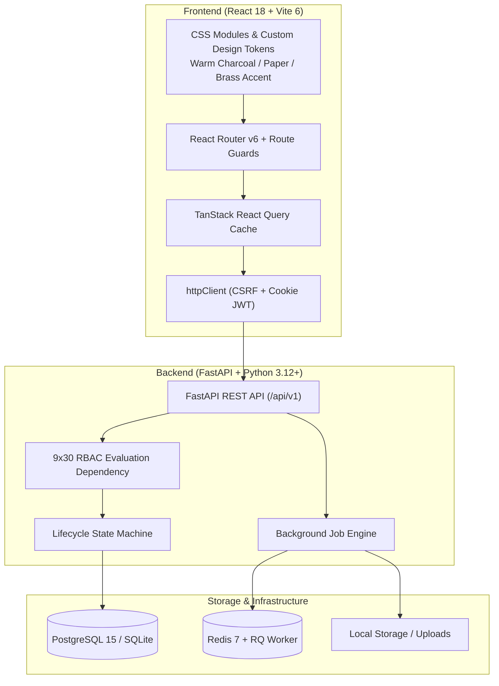

# HandoffScope

<p align="center">
  <strong>Evidence-led, permission-aware project handover platform for engineering teams.</strong>
</p>

<p align="center">
  
  
  
  
  
  
  
</p>

---

## 🎯 The Problem

Engineering knowledge transfers fail because they rely on rushed 1-on-1 walkthroughs, stale Confluence wikis, and informal Slack threads:
1. **Unverifiable Claims:** Handover documents state *"Auth service is ready for production"* without linking to the PR review, deployment checklist, or architectural decision.
2. **Permission Leaks:** Successors or departing staff are either over-permissioned (seeing sensitive HR/security notes) or under-permissioned (blocked from seeing relevant context).
3. **No Proof of Understanding:** A recipient saying *"I read the doc"* is not an acceptance of operational ownership.
4. **Stale Runbooks:** Repositories evolve while handovers remain frozen in time.

## 💡 The Solution: HandoffScope

HandoffScope treats a project handover as an **evidence-backed, permission-aware workflow**:
- **Automatic Ingestion:** Ingests issues, PRs, review discussions, commits, and uploaded technical documentation (`.pdf`, `.docx`, `.md`, `.txt`).
- **Ground-Truth Claims:** Every statement is backed by direct evidence references (Supported, Inferred, Conflicting, or Unknown).
- **Dual-Dimension State Machine:** Decouples handover lifecycle status (`DRAFT` → `RECONSTRUCTING` → `UNDER_REVIEW` → `APPROVED` → `TRANSFERRED`) from data freshness (`CURRENT`, `POTENTIALLY_STALE`, `CHANGED_SINCE_APPROVAL`).
- **Strict 9×30 RBAC Matrix:** Enforces boundary checks at Workspace, Project, and Case levels so restricted evidence never leaks into unauthorized packs.
- **Formal Responsibility Acceptance:** Distinguishes between reading a document, reviewing a transfer pack, and legally accepting operational ownership.

---

## 🏛️ Architecture & Tech Stack



### Backend
- **FastAPI:** High-performance async/sync REST endpoints with Pydantic v2 schemas.
- **SQLAlchemy 2.x & Alembic:** Declarative models, constraint naming conventions, cross-compatible PostgreSQL/SQLite engine.
- **Argon2id & Python-Jose:** Cryptographically secure password hashing, HttpOnly JWT cookies, and CSRF double-submit token protection.
- **Document Parsers:** Built-in parsers for PyMuPDF (`fitz`), `python-docx`, and structured Markdown.
- **Redis & RQ:** Asynchronous background processing across 3 priority queues (`handoffscope-import`, `handoffscope-extract`, `handoffscope-default`).

### Frontend
- **React 18 & Vite 6:** Instant HMR, production build in under 3 seconds.
- **Design Tokens:** Warm Charcoal dark mode (`#1a1816`), warm paper light mode (`#f5f0eb`), muted brass accent (`#b8860b`).
- **View Transition API:** Circular ripple clip-path theme toggle with `prefers-reduced-motion` graceful degradation.
- **Role-Aware UI:** Navigation items dynamically adapt to the active user's permissions.

---

## 👥 Demo Personas (Pre-Seeded)

All accounts share the default password: **`handoffscope-dev-2026`**

| Persona | Email | Workspace Role | Project Role | Operational Context |
|---|---|---|---|---|
| **Maya Sharma** | `maya.sharma@example.test` | `OWNER` | `LEAD` | Engineering Lead / Handover Initiator. Full administrative, audit, and case management capabilities. |
| **Arjun Patel** | `arjun.patel@example.test` | `ADMIN` | `CONTRIBUTOR` | Departing Lead Developer. Primary author of Atlas Platform auth, caching, and payment integration. |
| **Neha Gupta** | `neha.gupta@example.test` | `MEMBER` | `CONTRIBUTOR` | Designated Successor. Recipient view and responsibility acceptance workflow. |
| **Aisha Khan** | `aisha.khan@example.test` | `MEMBER` | `REVIEWER` | Senior Staff Reviewer. Approvals, verification checklists, and audit trails. |
| **Kabir Singh** | `kabir.singh@example.test` | `MEMBER` | `CONTRIBUTOR` | Platform Contributor. Author of architecture decision disputes in fixture. |
| **Dev Mehta** | `dev.mehta@example.test` | `MEMBER` | `CONTRIBUTOR` | Infrastructure / DevOps Engineer. |
| **Priya Nair** | `priya.nair@example.test` | `MEMBER` | `CONTRIBUTOR` | QA & Testing Specialist. |

---

## 🚀 Quickstart Guide

For a full step-by-step walkthrough, see [**`GETTING_STARTED.md`**](./GETTING_STARTED.md).

### Option A: Local Run (Fastest — No Docker Required)

```bash
# Terminal 1 — Backend
cd backend
python -m uvicorn app.main:app --reload --port 8000

# Terminal 2 — Frontend
cd frontend
npm install
npm run dev
```
Open **[http://localhost:5173](http://localhost:5173)** in your browser.

### Option B: Docker Compose

```bash
docker compose up --build
```

---

## 🧪 Testing

```bash
# Run backend test suite (unit + api tests)
cd backend
python -m pytest tests/
```

All 11 unit and API tests pass covering security hashing, state machine transitions, document parsers, and health checks.

---

## 📂 Project Structure

```text
HandoffScope/
├── backend/
│   ├── alembic/                # Database migrations
│   ├── app/
│   │   ├── api/v1/             # REST API routers
│   │   ├── core/               # Security, config, RBAC dependencies, middleware
│   │   ├── db/                 # Base, session, enums, mixins
│   │   ├── integrations/       # GitHub client, document parsers, LLM adapters
│   │   ├── modules/            # Domain modules (auth, projects, cases, sources, jobs)
│   │   ├── seed/               # Demo seed and 63-item synthetic fixture
│   │   ├── storage/            # Local filesystem abstraction
│   │   └── workers/            # RQ task runners and retry logic
│   ├── tests/                  # Pytest test suites
│   ├── Dockerfile
│   └── pyproject.toml
├── frontend/
│   ├── src/
│   │   ├── api/                # API client wrappers
│   │   ├── app/                # App router, providers, route guards
│   │   ├── context/            # AuthContext, ThemeContext
│   │   ├── hooks/              # usePermissions, useAuth
│   │   ├── layouts/            # AppShell, Sidebar, Topbar, AuthLayout
│   │   ├── pages/              # Overview, Projects, Cases, Sources, Login, etc.
│   │   └── styles/             # Design tokens, themes, typography
│   ├── Dockerfile
│   ├── package.json
│   └── vite.config.js
├── docker-compose.yml
├── GETTING_STARTED.md
└── README.md
```

---

## 📜 License

MIT License. Built for the Hackathon Engineering Transition Platform Challenge.
